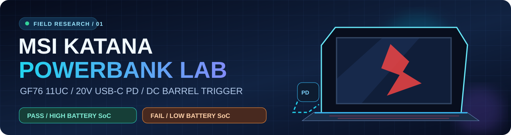
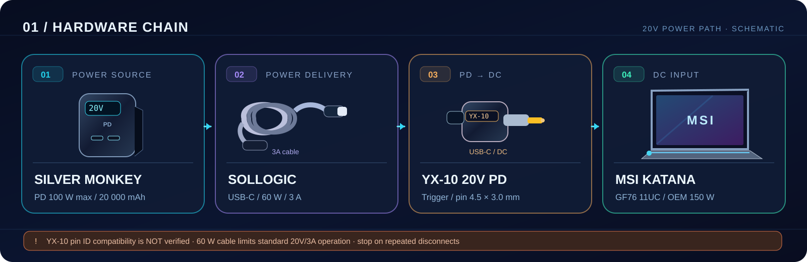
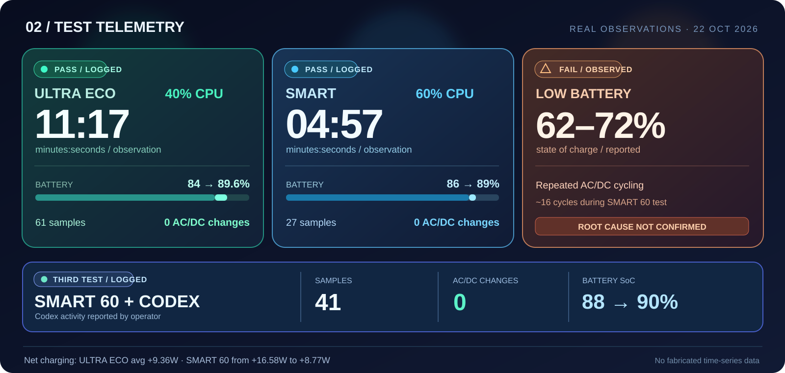

  
  
  
  

<h1 align="center">MSI Katana GF76 11UC × Silver Monkey 100 W</h1>

<b>Eksperyment: laptop gamingowy zasilany przez USB-C Power Delivery → adapter DC</b> 
Prawdziwe pomiary · trzy udane obserwacje · niestabilność przy niższym stanie akumulatora · otwarta diagnoza

<a href="#wyniki">WYNIKI</a> · <a href="#sprzet">SPRZĘT</a> · <a href="#diagnoza">DIAGNOZA</a> · <a href="#dane">DANE</a> · <a href="#roadmap">ROADMAP</a> · <a href="https://github.com/paweldabek1990/MSI-Katana-USB-C-PD-Lab/issues/1">TEST 100 W ↗</a>

> [!IMPORTANT]
> **Potwierdziliśmy działanie — nie potwierdziliśmy pełnej kompatybilności.** Laptop pracował i ładował baterię przez 11 min 17 s oraz 4 min 57 s bez zarejestrowanych przełączeń; późniejszy test SMART 60 podczas aktywności Codexa zakończył się 41 próbkami bez wykrytej zmiany zasilania. Natomiast przy ok. 62–72% stanu akumulatora wielokrotnie tracił zasilanie z powerbanku. To **laboratoryjny dziennik obserwacji**, a nie sprawdzony zamiennik fabrycznego zasilacza.

## ⚡ Jak połączyliśmy urządzenia?

## 📈 Wyniki testów

| Profil Windows | Stan baterii MSI | Czas | Próbki | Zmiany AC/DC | Co zaobserwowaliśmy |
|:---|:---:|---:|---:|---:|:---|
| **ULTRA ECO 40%** | 84% → 89,6% | **11:17** | 61 | **0** | Śr. **+9,36 W** netto do akumulatora |
| **SMART 60%** | 86% → 89% | **04:57** | 27 | **0** | Ładowanie **+16,58 → +8,77 W** |
| **SMART 60% + Codex aktywny** | **88% → 90%** | ok. 3 min* | **41** | **0** | Zakończenie: `Completed normally`; raport bez danych mocy wejściowej |
| **SMART 60%** | ok. 70–72% | — | obserwacja | ok. **16 cykli** | Powtarzające się rozłączenia, miganie ekranu |
| **ULTRA ECO 40%** | **62%** | — | obserwacja | wiele cykli | Brak stabilnego ładowania |

*Skrypt miał limit 3 minut, ale raport TXT nie podaje dokładnego czasu między pierwszą i ostatnią próbką. Nie ma też w nim szczegółowego rozkładu obciążenia CPU; aktywność Codexa zgłosił operator. Krótkie zaniki między próbkami mogły zostać pominięte.*

  

> [!NOTE]
> Dane **BatteryRateW** dotyczą energii wpływającej **do baterii laptopa**, a nie całkowitej mocy pobieranej z powerbanku. Wyświetlacz Silver Monkey przy stabilnym ładowaniu wskazywał orientacyjnie **20 V i 1,5–2,0 A (30–40 W)**. Nie zarejestrowano wartości szczytowych w chwili rozłączenia.

## 🧰 Zestaw pomiarowy

| Komponent | Specyfikacja / status |
|:---|:---|
| 💻 **Laptop** | MSI Katana GF76 11UC · Intel Core i5-11400H · RTX 3050 |
| 🔌 Zasilacz fabryczny | **150 W / 20 V / 7,5 A** |
| 🔋 **Powerbank** | Silver Monkey · ok. 20 000 mAh · wyjście USB-C PD deklarowane do 100 W |
| 🧵 Kabel podczas testów | Sollogic USB-C ↔ USB-C · **60 W / 3 A** |
| 🔄 Adapter | **YX-10**, oznaczenie **20V PD**, wtyk DC ok. **4,5 × 3,0 mm z pinem** |
| 🪫 Stan baterii MSI | Nominalnie **52 007 mWh** · ostatnia pełna pojemność **33 653 mWh** · **64,7%** fabrycznej |
| 🆕 Kolejny przewód | UGREEN USB-C **100 W / 5 A z e-markerem** · zamówiony, **nieprzetestowany** |

**Warto pamiętać:** ustawienie maksymalnego stanu procesora na 40% albo 60% nie ogranicza mocy całego laptopa do 40 albo 60 W. W szczególności nie ogranicza wprost prądu ładowania jego baterii.

## 🔎 Diagnoza

| Kategoria | Stan | Uzasadnienie |
|:---|:---:|:---|
| Praca i ładowanie przy 84–90% | **ZMIERZONE** | Raporty Windows: zasilanie AC/Charging, 0 wykrytych zmian źródła w trzech obserwacjach |
| Wielokrotne zaniki przy 62–72% | **ZAOBSERWOWANE** | Miganie ekranu i cykliczny reset połączenia |
| Większy prąd ładowania przy niższym SoC | **HIPOTEZA** | Możliwy wzrost zapotrzebowania, brak pomiaru szczytowego |
| Ograniczenie kabla 60 W | **MOŻLIWE** | Przewód 3 A ogranicza standardowy tor PD przy 20 V do 60 W |
| Problem adaptera / pinu ID | **NIEWYKLUCZONY** | Niepotwierdzona zgodność elektryczna konkretnego YX-10 z MSI |
| Rozwiązanie po wymianie kabla na 100 W | **NIEZWERYFIKOWANE** | Kabel jest dopiero zamówiony |

> [!WARNING]
> Po wielokrotnym przełączaniu zasilania **nie wykonuj kolejnych prób z niezweryfikowanym adapterem pod obciążeniem**. Kompatybilność końcówki, polaryzacja, zachowanie pinu identyfikacyjnego i graniczne parametry toru wymagają potwierdzenia. Do normalnej pracy służy oryginalny zasilacz MSI 150 W.

Więcej: **[pełna analiza objawów i hipotez](docs/diagnosis.md)**.

## 📂 Dane i dokumentacja

| Zasób | Do czego służy |
|:---|:---|
| [**Metodyka testów**](docs/methodology.md) | Co i jak było mierzone, czego dane *nie* potwierdzają |
| [**Analiza awarii**](docs/diagnosis.md) | Hipotezy przeciążenia, negocjacji PD i zgodności adaptera |
| [**Zestawienie CSV**](data/test-results.csv) | Dane zagregowane gotowe do wykorzystania w arkuszu |
| [**Słownik danych**](data/README.md) | Interpretacja kolumn i rodzaju dowodów |
| [**Zgłoś własny pomiar**](../../issues/new/choose) | Formularz GitHub Issues do przyszłych raportów |
| [**Grafika: tor zasilania**](assets/wiring.svg) | Schemat użytego zestawu |
| [**Grafika: wyniki**](assets/results.svg) | Porównanie krótkich testów i nieudanych prób |

## 🗺️ Następny eksperyment

- [x] Potwierdzić ładowanie z USB-C PD → DC przy wysokim stanie baterii
- [x] Zmierzyć ciągłość AC/Charging w dwóch profilach
- [x] Wykonać trzeci pomiar SMART 60 przy aktywnej pracy Codexa (41 próbek, 0 wykrytych zmian)
- [x] Udokumentować powtarzalny problem przy niższym stanie baterii
- [ ] Zweryfikować parametry elektryczne i identyfikację YX-10
- [ ] [Zbadać zgodny elektrycznie tor z kablem USB-C **100 W / 5 A**](../../issues/1)
- [ ] Zmierzyć moc szczytową odpowiednim miernikiem USB-C PD bez cyklicznych prób na laptopie
- [ ] Ustalić bezpieczne warunki pracy albo jednoznacznie odrzucić konfigurację

<b>🇬🇧 English summary — click to expand</b>

This is an independent field report for an **MSI Katana GF76 11UC**, a **Silver Monkey 100 W USB-C PD power bank**, a **60 W/3 A USB-C cable**, and a **YX-10 20 V PD-to-barrel trigger**.

The running laptop successfully charged in two initial brief tests at higher battery state-of-charge (84–89%) with **zero reported AC/DC source changes** (11:17 in ULTRA ECO 40%, 04:57 in SMART 60%). A third SMART 60 test during reported Codex activity logged 41 samples, no detected power-source transitions, and laptop SoC rising from 88% to 90%. Sampling does not rule out shorter transients. At lower state-of-charge (approximately 62–72%), repeated disconnection/reconnection and screen flicker occurred, including under the lower-power profile. **Root cause remains unproven.** A 100 W e-marked cable has been ordered but not yet tested. **This is not a validated safe power-supply replacement.**

---

<b>Independent real-world measurements · 22 October 2026</b> Not affiliated with MSI, Silver Monkey, Dell, or UGREEN. Equipment drawings are schematic, not product photographs.

